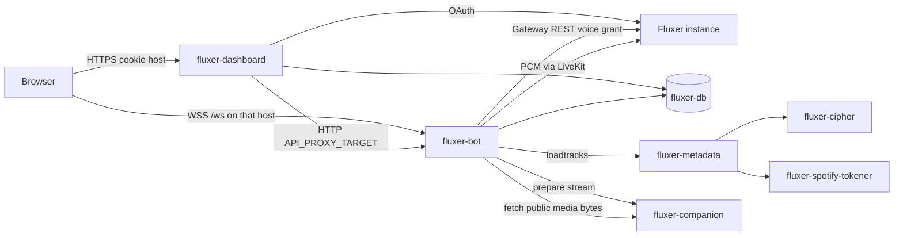

# Application layout

DimbyBot for Fluxer is one Git checkout and two applications. The **Bot** is a native Fluxer process. The **Dashboard** is a nested Next.js application. They share a PostgreSQL database and a session secret, and they talk over HTTP and an authenticated WebSocket. Music search helpers run as separate containers. Fluxer itself (REST, Gateway, OAuth, and LiveKit) stays outside this Compose project.

Retired Discord source lives under `legacy/discord/` and is outside the active compile, test, lint, and image graphs. Names are in [GLOSSARY.md](../GLOSSARY.md). The split between the two applications is [ADR 0007](adr/0007-two-apps-nested-dashboard.md). Native playback is [ADR 0010](adr/0010-fluxer-native-music.md).

## Source layout

```text
src/server.ts          Bot entry (compiles to dist/server.js)
src/commands/          Prefix commands (!play, !queue, playlists, control channel)
src/botApi/            HTTP and WebSocket the Dashboard calls
src/lib/               Runtime: Fluxer client, music, logging, database
src/lib/fluxer/        REST, Gateway, voice grants, membership checks
src/lib/music/         Queue, playlists, Lavalink search, companion streams, FFmpeg, LiveKit
src/repositories/      Persistence
src/shared/            Code both applications may import (auth, DTOs, WebSocket contract)
src/util/              Bot helpers
src/types/             App-owned types
src/web/               Dashboard only — never imported by Bot code
  app/                 Routes and route-local UI
  server/              Next server helpers and "use server" actions
  lib/                 Helpers that are not Next-server-bound
  components/ hooks/   UI
prisma/                Schema and migrations (the Bot applies them on startup)
Lavalink/              Metadata image (Lavalink.jar plus a generated application.yml)
legacy/discord/        Archived Discord implementation
```

Root `tsc` uses `rootDir: src` and excludes `src/web`, so `yarn build:bot` emits `dist/` and does not emit the Dashboard. The Dashboard builds with its own Next config (`output: "standalone"`) via `yarn build:web`. Shared modules in `src/shared/` are compiled into `dist/shared/` for the Bot and imported by the Dashboard as `@/shared/*`.

## How the two applications divide work

| Concern                            | Bot                                                               | Dashboard                                                  |
| ---------------------------------- | ----------------------------------------------------------------- | ---------------------------------------------------------- |
| Fluxer Gateway and prefix commands | Owns the session and replies in chat                              | Shows the configured prefix; does not speak to the Gateway |
| Queue, playback, voice             | Music service, FFmpeg, LiveKit                                    | Sends mutations and renders player state                   |
| Search metadata                    | Calls Lavalink `/v4/loadtracks`                                   | Sends the query through the Bot API                        |
| YouTube bytes                      | Resolves a stream through the companion, then fetches and decodes | Never talks to the companion                               |
| Sign-in                            | Verifies the shared Better Auth session                           | Runs Fluxer OAuth and sets the `dimby-fluxer` cookie       |
| Database                           | Migrations on startup, sessions, playlists, queue snapshots       | Reads the same database for sessions and the status probe  |

The contract is HTTP plus `/ws`. Shared DTOs live in `src/shared/`. The Dashboard does not import Bot runtime code, and the Bot does not import `src/web/`.

Dashboard pages:

| Path                                         | Role                                                                                                                    |
| -------------------------------------------- | ----------------------------------------------------------------------------------------------------------------------- |
| `/`                                          | Sign-in                                                                                                                 |
| `/dashboard` and `/dashboard/[guildId]`      | Guild list and live player                                                                                              |
| `/playlists` and `/playlists/[playlistId]`   | Owner-scoped playlists                                                                                                  |
| `/status`                                    | Independent probes of PostgreSQL and the Bot `/health` endpoint                                                         |
| `/admin`, `/admin/database`, `/admin/errors` | Operator pages. Admin, download, alert, and countdown Bot routes answer that the feature is unavailable in this release |

Browser calls stay on the Dashboard origin. Server actions and `app/api` routes forward to the Bot with `API_PROXY_TARGET` (host default `http://127.0.0.1:3010`, Compose `http://fluxer-bot:3010`). Live player updates use a cookie-authenticated upgrade on `/ws`. In production, publish `/ws` on the same host as the Dashboard cookie and set `WEBSOCKET_CLIENT_URL=wss://that-host/ws`. The Bot API stays on a private address (`BOT_API_REQUIRE_PRIVATE_CLIENT_IP=1`).

## Containers

Compose project name: `dimbybot-fluxer`. Every service joins the `fluxer-internal` bridge. Nothing here is shared with a Discord Compose project: service names are `fluxer-*`, volumes are separate, and the local image names default to `dimbybot-fluxer-bot`, `dimbybot-fluxer-dashboard`, and `dimbybot-fluxer-metadata`.



| Service                  | Image                                                           | Purpose                                                                                                                                                                                  | Listens                                                         |
| ------------------------ | --------------------------------------------------------------- | ---------------------------------------------------------------------------------------------------------------------------------------------------------------------------------------- | --------------------------------------------------------------- |
| `fluxer-db`              | `postgres:18-alpine`                                            | Sessions, playlists, and music snapshots for both applications. Database default `dimbybot_fluxer`, user `fluxer`.                                                                       | `5432` inside the network. Host dev publishes `127.0.0.1:5434`. |
| `fluxer-bot`             | `Dockerfile` (`node:24-bookworm-slim`)                          | Prefix commands, music, Fluxer Gateway, Bot API, and `/ws`. Applies Prisma migrations. Debian because LiveKit’s Linux binaries need glibc. FFmpeg is installed for pipe-only PCM decode. | `3010`. Published on `127.0.0.1:3010` by default.               |
| `fluxer-dashboard`       | `Dockerfile.web` (`node:24-alpine`)                             | Next.js UI, Fluxer OAuth, and proxies to the Bot. Alpine is enough because this image does not load the voice SDK. Defined in `docker-compose.dashboard.yml`, not the base file.         | `3000`. Published on `127.0.0.1:3000` by default.               |
| `fluxer-metadata`        | `Lavalink/Dockerfile` (Temurin 17 JRE on Jammy, Lavalink 4.2.2) | Metadata search only (`/v4/loadtracks`). It does not own a queue or a Fluxer voice session. The entrypoint writes `application.yml` from `LAVALINK_*`.                                   | `2333`. Host dev publishes `127.0.0.1:2334`.                    |
| `fluxer-cipher`          | pinned `ghcr.io/kikkia/yt-cipher`                               | Remote signature helper for the metadata image’s YouTube plugin.                                                                                                                         | `8001`, reached as `http://fluxer-cipher:8001`.                 |
| `fluxer-spotify-tokener` | pinned `ghcr.io/topi314/spotify-tokener`                        | Anonymous Spotify token endpoint so catalog metadata can load without embedding playback inside Lavalink.                                                                                | `8080`, path `/api/token`.                                      |
| `fluxer-companion`       | pinned `quay.io/invidious/invidious-companion`                  | YouTube playback preparation. The Bot asks it for a stream, then fetches the bytes itself.                                                                                               | `8282`. Host dev publishes `127.0.0.1:8283`.                    |

`fluxer-metadata` starts after `fluxer-cipher` and `fluxer-spotify-tokener`. `fluxer-bot` waits until `fluxer-db` and `fluxer-metadata` are healthy and `fluxer-companion` has started. `fluxer-dashboard` waits until `fluxer-db` and `fluxer-bot` are healthy.

Container entrypoints build `DATABASE_URL` from `POSTGRES_*` and `POSTGRES_INTERNAL_HOST=fluxer-db` when `FLUXER_DOCKER_DATABASE_URL` is empty. The host `DATABASE_URL` (`127.0.0.1:5434`) is not forwarded into containers, where `localhost` would be the container itself.

### Volumes

| Volume                    | Mount                  | Contents                                                                                                                     |
| ------------------------- | ---------------------- | ---------------------------------------------------------------------------------------------------------------------------- |
| `fluxer-postgres`         | `/var/lib/postgresql`  | Database files. `down` keeps this volume.                                                                                    |
| `fluxer-storage`          | `/app/storage`         | Bot logs under `storage/fluxer`.                                                                                             |
| `fluxer-metadata-plugins` | `/app/plugins`         | Lavalink plugin JARs downloaded on startup. Recreate the volume after a plugin version change if an old JAR is still loaded. |
| `fluxer-companion-cache`  | `/var/tmp/youtubei.js` | Companion cache.                                                                                                             |

### Playback path

1. A prefix command or a Dashboard mutation reaches the Bot music service.
2. The Bot asks `fluxer-metadata` for track or playlist metadata. Spotify URLs stay catalog identity; YouTube search still goes through the metadata image and `fluxer-cipher`.
3. Just before audible playback, the Bot asks `fluxer-companion` for a YouTube byte stream, fetches those bytes itself, and decodes them with FFmpeg pipes. User-supplied URLs are not handed to Lavalink or to FFmpeg’s network client.
4. PCM is published into the Fluxer LiveKit room from the voice grant. The Dashboard does not join voice.

Saved queues restore paused. An authorized user has to resume them. One Bot process per application token.

## How to run it

**Host applications, containers only for dependencies.** This is the usual local setup. Start `fluxer-db`, `fluxer-metadata`, `fluxer-companion`, `fluxer-cipher`, and `fluxer-spotify-tokener` with `docker-compose.yml` plus `docker-compose.dev.yml` (that override publishes the database, metadata, and companion ports). Then `yarn start` and `yarn dev:web`. Both processes load `.env.fluxer`. An optional ignored `.env.fluxer.local` overlays host-only values.

**Bot in a container, still developing.** `./dev-env.sh up` or `yarn docker:dev:up` uses `Dockerfile.dev`, runs `yarn dev`, and bind-mounts the repo. The dev image is also Debian Bookworm with FFmpeg.

**Both applications in containers.**

```bash
docker compose --env-file .env.fluxer -f docker-compose.yml -f docker-compose.dashboard.yml up --build -d
```

There is no configured image publication or remote deploy. CI validates both applications only.

## Health

| Probe                                     | Meaning                                                                                                                           |
| ----------------------------------------- | --------------------------------------------------------------------------------------------------------------------------------- |
| Bot `GET /health`                         | Process is up. Docker uses this as the image healthcheck. It does not mean the Gateway is connected.                              |
| Bot `GET /ready`                          | Gateway is ready. Returns 503 while the Bot is still connecting or shutting down.                                                 |
| Dashboard `GET /api/health`               | Process liveness for the Dashboard image. It does not call the database or the Bot, so the Docker probe stays inside its timeout. |
| Dashboard `GET /api/status` and `/status` | Separate checks: `SELECT 1` against PostgreSQL, and Bot `/health` through `API_PROXY_TARGET`.                                     |

## Outside this Compose project

- **Fluxer.** `FLUXER_INSTANCE_ORIGIN` is discovered through `/.well-known/fluxer`. API, Gateway, assets, and the OAuth authorization URL come from that instance. Voice media terminates on the LiveKit endpoint in the voice grant.
- **`legacy/discord/`.** Historical commands, events, and tests. The Fluxer process does not load them, and the production image context does not include them.
- **Deferred product surface.** Countdowns, local-file playback, upload alerts, guild log forwarding, autoplay, and admin tools are not active jobs or commands. Their Bot API paths respond that the feature is unavailable.
